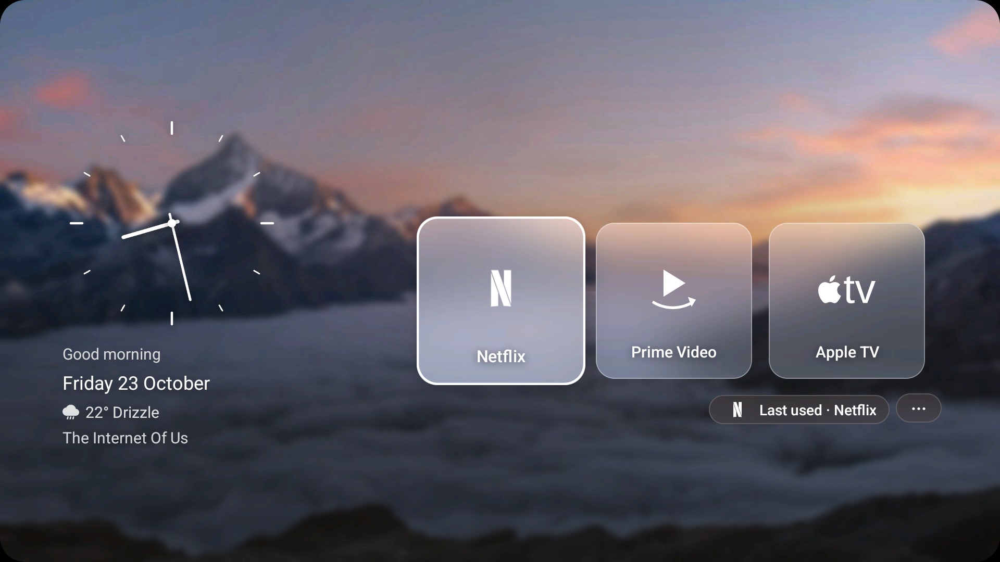
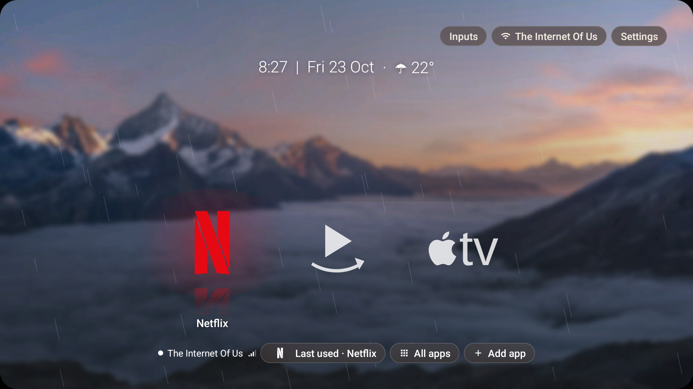
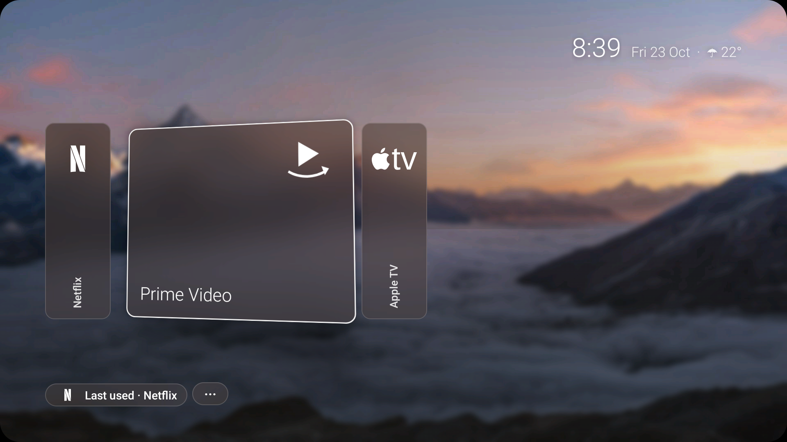
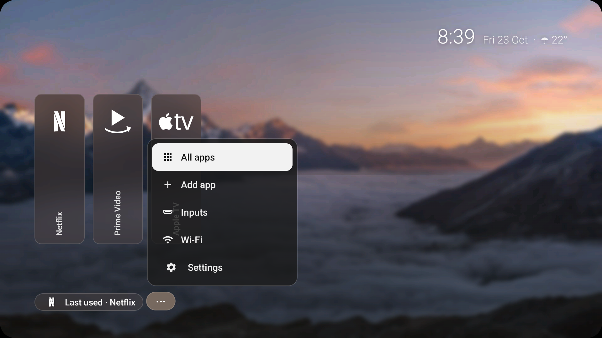

# TV Home

A fast home screen for a slow Android TV that looks like an Apple TV: one of your own photos as the wallpaper, a big clock, frosted iOS 18-style panels, and a dock with the apps you actually use.


*A real screenshot from an Android 11 TV with 1.4 GB of RAM. The Wi-Fi name is replaced with a generic label.*

- **Wallpaper:** a random photo from `launcher/app/src/main/assets/wallpapers` each time the launcher starts. Drop your own photos in a folder and run `python3 docs/design/prepare_wallpapers.py <folder>`: it makes the 1080p crops, a blurred twin for the frosted panels, and `themes.json`, which says per photo whether each screen region is pale or dark so the text and panels flip between dark-on-light and light-on-dark. Nothing is computed on the TV.
- **Header:** greeting, clock and date centred near the top; three frosted pills top right: Inputs, Wi-Fi (the network name's first word), Settings.
- **Dock:** Netflix, YouTube, and an All apps tile that opens every other app A to Z. The focused tile lifts a little with a soft shadow, tvOS style, and its name appears above the row. The row scrolls sideways when it gets long.
- **Add app:** the pill at the bottom-right of the row opens a picker and pins the app you choose. Hold OK on a tile to remove it. Your choices are saved on the TV.
- **VPN status:** a chip at the bottom-left of the row shows "VPN off", or "VPN · United States" with a green dot while a VPN is on. Detecting a VPN is offline. The country comes from one request to a free IP lookup service (api.country.is, then ipwho.is as a fallback), made only while a VPN is up and once per VPN connection, so the service sees the VPN's address and never your real one.
- **Rounded corners:** a black mask with 48 px corners over the launcher, so the square panel looks like a rounded display.
- **Lean on purpose:** no libraries, no live blur (the panels show a pre-blurred copy of the photo), no animations beyond the focus lift, and no network use at all while the VPN is off.

Forked from [Gathin23/cleanyourtv](https://github.com/Gathin23/cleanyourtv) (MIT) and inspired by [manojm321/jain-tv-launcher](https://github.com/manojm321/jain-tv-launcher). The launcher code is rewritten; the ADB install, debloat and restore tooling and the TV lists in `examples/` come from upstream.

## This fork: what pradhul/minimal-tv-launcher adds

This is [pradhul/minimal-tv-launcher](https://github.com/pradhul/minimal-tv-launcher), a fork of [kleviss/minimal-tv-launcher](https://github.com/kleviss/minimal-tv-launcher) by Klevis Xhyra. All credit for the original Apple TV-style launcher, the frosted panels and the ADB tooling goes upstream. The changes below were made from v4 to v23 and tested on an Android 14 Mi TV (1920×1080).

### Three card styles

You can switch styles from the **Card style…** button in the launcher settings menu. Glass tiles is the default.

| Glass tiles (default) | Floating icons (rainy day) |
|---|---|
|  |  |
| **Tall posters** | **⋯ menu** |
|  |  |

- **Glass tiles (layout C):** an analog clock on the left with the greeting, date, weather and Wi-Fi name under it. On the right are square frosted-glass tiles for your apps and HDMI devices, with a **Last used** pill and a **⋯** pill below them.
- **Floating icons:**
  - Icons float with no card behind them. The focused icon grows and takes its brand colour (Netflix red, Prime blue, …).
  - Near-black or near-white brand colours, such as Apple TV's black, switch to white or black depending on how bright the wallpaper is behind the row. Coloured brands are never changed.
  - The focused icon gets a soft halo in its brand colour and a faint mirrored reflection.
  - The clock is a single slim line: `8:18 | Fri 23 Oct · ☂ 21°`.
  - When it is raining (drizzle, rain, showers or thunderstorm), you get a light blue tint and slow diagonal rain streaks. These run at up to 30 fps and stop when the launcher is not on screen.
- **Tall posters (layout A):**
  - Tall frosted posters on the left at about half the screen height. The focused one widens to show the app name and what was last playing in it.
  - A slim digital clock, date and weather sit top right. **Last used** and **⋯** sit bottom left.
  - The focused poster tilts in 3D toward the direction you moved (about 9°), and a glare band sweeps across its glass once.

### Menus and settings

- **⋯ pill** (Glass and Posters): opens All apps, Add app, Inputs, Wi-Fi and Settings. The menu opens above the pill when there is no room below it.
- **Long-press Settings, or long-press ⋯:** opens the launcher settings:
  - **Auto-jump to HDMI:** when a device connected by HDMI turns on (for example a console or a set-top box), the TV switches to that input.
  - **Night mode:** from 22:00 to 06:00 the wallpaper is dimmed and the text turns amber.
  - **Simple icons:** single-colour app glyphs from [Simple Icons](https://simpleicons.org) (CC0) and Material Icons (Apache-2.0) instead of the apps' own icons. Since v32 the streaming apps (Netflix, YouTube, SmartTube, Prime Video, Apple TV, Airtel Xstream, ZEE5, JioHotstar, Sony LIV, Sun NXT) use thin line icons from [Arcticons](https://github.com/Arcticons-Team/Arcticons) (CC BY-SA 4.0), converted to vector drawables (`res/drawable/ic_app_arc_*.xml`, stroke width unchanged); other unknown apps keep the letter tile. Since v33 Play Store, Gallery, TV Bro and Send Files To TV use Arcticons too (14 in all), and All apps uses the same glyphs, shows the home photo (light blur, same dim) behind the grid, and marks the selected app with a soft glow in its brand colour (white when it has none).
  - **Auto-switch style daily:** rotates Glass → Floating → Posters once a day, at local midnight or when you come back to Home. It is off by default. If you pick a style by hand while it is on, that style becomes today's style and the rotation continues from there.
  - **Card style…** and the system settings.
- **Inputs menu:** readable rows listing the HDMI and AV inputs, each opening its input.

### Home screen extras

- **Wallpapers:** separate day and night sets of real photos, chosen by the time of day (06:00–22:00 is day). Each photo has a pre-blurred copy that the frosted panels use.
- **Tall posters, lighter blur (v26):** the posters style shows a lighter-blurred copy of the photo (`-light.jpg`, Gaussian 2.5 vs 6 for `-soft.jpg`) with a slight dim by day; switching styles swaps it straight away.
- **Weather wallpapers (v25):** overcast skies switch to a cloudy set, rain or drizzle to a rainy set, each with day and night photos (Unsplash, Unsplash License; sources in `themes.json`). Other weather uses the normal sets. Checked with every weather refresh.
- **Weather:** the current temperature and conditions from [Open-Meteo](https://open-meteo.com), which needs no API key. It refreshes every 30 minutes and the last answer is cached, so a restart shows it at once.
- **Forecast + air quality (v25):** the weather line beside the clock can be focused with the remote; focus or OK opens a panel with the next 6 hours (temperature, rain chance) and the current US AQI with PM2.5 and a colour label (Open-Meteo air-quality API). Back closes it.
- **Weather effects (v25, every style):** rain or drizzle shows the rain overlay, fog a slow mist, a clear night a soft static glow. All are cheap: no bitmaps, ≤30 fps rain, 8 fps mist, a glow that never animates.
- **Bluetooth devices (v25):** line icons by the clock for a connected remote and a speaker/headphones. Connected is full ink, disconnected dimmed, never-connected-this-session hidden. A thin battery bar shows when the level is known, and an amber dot marks a remote under 20%. Needs `adb shell pm grant com.minimaltv.home android.permission.BLUETOOTH_CONNECT`.
- **Last used pill:** opens the app you last played something in, showing the title when one is known. It is hidden while an HDMI tile is shown.
- **Wi-Fi (v27):** no network name as text any more. The Wi-Fi control has a line-style icon with 0–4 bars (from RSSI, updated on RSSI and network-state broadcasts), plus no-internet, off and Ethernet variants. Floating icons: the Wi-Fi pill is just the icon. Glass and posters: the icon sits on the ⋯ pill, which has Wi-Fi in its menu. A VPN still gets its short status line.
- **Scrolling app row (v27):** when apps overflow, the row fades softly only on a side with more apps, and the focused tile's scale, glow and shadow are never clipped.
- **Wi-Fi (before v27):** the full network name with signal bars. HDMI devices show up as tiles named after the device (for example "Nintendo Switch"), and the launcher remembers the name for each port.

### v30: daily Bing wallpaper and holiday line

- **Daily Bing wallpaper** (launcher settings → *Daily Bing wallpaper*, on by default). The launcher fetches Bing's small JSON list (en-IN, 8 entries), checks each one's 64×36 thumbnail (about 1 KB) for brightness, and downloads **one** 1920×1080 photo: the brightest by day, the darkest by night (22:00–06:00), never the one already showing. Only that photo and its on-device -soft / -light / -blur copies are kept (in the app's files/bing); the previous set is deleted. A new pick comes at the morning and evening switch, and on start or boot when the stored one is stale. Cloudy or rainy weather still shows the bundled weather photos; offline or on failure the bundled photos are used. Bing's copyright line sits in tiny text at the bottom-right. The small ↻ icon at the top-right fetches the next pick at once (it spins while downloading).
- **Holiday line** at the top-left: the next holiday and a countdown ("Deepavali · in 6 days", "· tomorrow", "Happy Deepavali" on the day). From a bundled list of national holidays and Karnataka festivals for 2026–2027 (`assets/holidays.json`) plus Nager.Date's India list, cached and refreshed weekly.
- **Less blur:** the glass and floating background is now GaussianBlur(3) (was 6) and the posters background GaussianBlur(1.5) (was 2.5), for the bundled photos and the Bing photo alike; the frosted panels keep their heavy blur. The scrim behind the clock and the posters day dim are a little stronger to keep text readable.

### Debug ADB extras

```bash
adb shell am start -n com.minimaltv.home/.MainActivity --es wallpaper 16        # force a photo (until the next day/night switch)
adb shell am start -n com.minimaltv.home/.MainActivity --es style glass         # or floating | posters
adb shell am start -n com.minimaltv.home/.MainActivity --ez forceRain true      # rain overlay, not saved
adb shell am start -n com.minimaltv.home/.MainActivity --es forceFx mist        # rain | mist | glow | none, not saved
adb shell am start -n com.minimaltv.home/.MainActivity --ez openForecast true   # open the forecast panel
adb shell am start -n com.minimaltv.home/.MainActivity --es previewApps a.b,c.d  # preview a dock list, never saved; 'none' ends it
adb shell am start -n com.minimaltv.home/.MainActivity --ez openMore true       # open the ⋯ menu
adb shell am start -n com.minimaltv.home/.MainActivity --ez bingRefresh true    # fetch the next Bing pick now (one download)
adb shell am start -n com.minimaltv.home/.MainActivity --es holidayDate 2026-11-07   # holiday line as on that day; "" ends it
adb shell am start -n com.minimaltv.home/.MainActivity --es holidayText "Happy Diwali"  # show any text there; "" ends it
```

### Install a build with ADB

```bash
adb connect <tv ip>:5555
adb install -r minimal-tv-launcher-v25.apk
adb shell cmd package set-home-activity --user 0 com.minimaltv.home/.MainActivity
```

To build it yourself, see **Build and install** below. Release builds are signed with the debug key, so they install over each other.

## Change the default dock

The dock starts from the list in `launcher/app/src/main/res/values/config.xml`. Once you add or remove an app on the TV, your saved list wins and this file is only the starting point. To go back to the file's list, run `pm clear com.minimaltv.home` over ADB. Find package names with:

```bash
TV_HOST=<tv ip> tools/venv/bin/python -I tools/tv.py 'pm list packages'
```

## Build and install

On the TV: Settings, Device Preferences, About, press OK on **Build** seven times, then Developer options, turn on **USB debugging** (and **Network debugging** if listed).

On the Mac: JDK 17 and the Android SDK (platform 34, build-tools 34), then:

```bash
python3 -m venv tools/venv
tools/venv/bin/pip install -r tools/requirements.txt
TV_HOST=<tv ip> launcher/build-and-install.sh
```

Accept the "Allow USB debugging?" prompt on the TV. The script builds the APK, installs it, makes it the Home app, and disables the stock launcher (disabled, never uninstalled).

## Debloat and undo

Pick or write a list (one package per line, see `examples/`), then:

```bash
TV_HOST=<tv ip> tools/disable.sh <list>
```

To undo only that list and keep this launcher as Home, enable the packages again over ADB:

```bash
TV_HOST=<tv ip> tools/venv/bin/python -I tools/tv.py 'for p in <package> <package>; do pm enable $p; done'
```

`tools/restore.sh <list>` is the full way back to stock: it re-enables the list, re-enables the stock launcher and makes it Home again. See `docs/TROUBLESHOOTING.md` if Home does not switch.

## Licence

MIT, see `LICENSE`.

Streaming-app glyphs `launcher/app/src/main/res/drawable/ic_app_arc_*.xml` are adapted from [Arcticons](https://github.com/Arcticons-Team/Arcticons) by the Arcticons team, licensed [CC BY-SA 4.0](https://creativecommons.org/licenses/by-sa/4.0/); those files stay under CC BY-SA 4.0. Brand marks belong to their owners.
