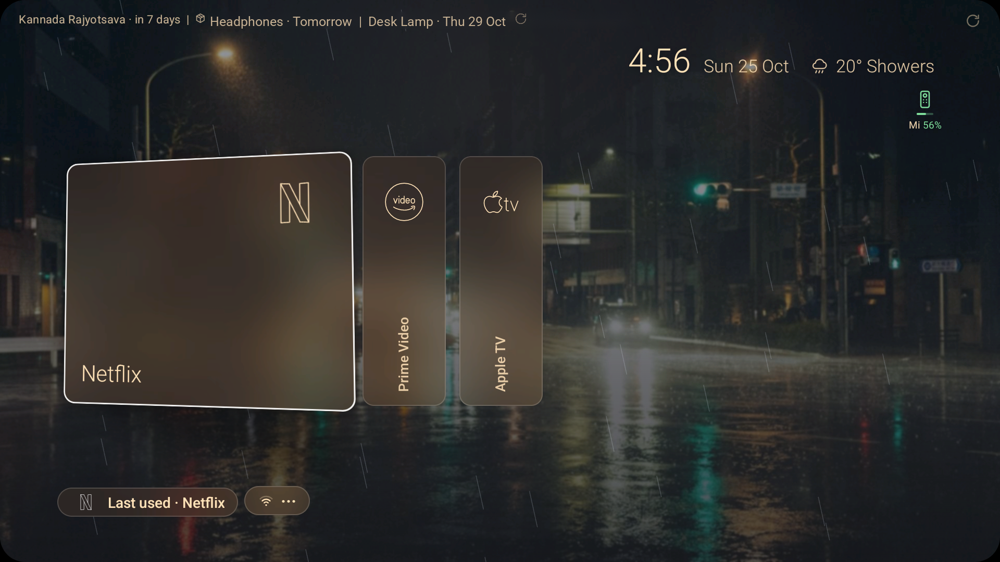
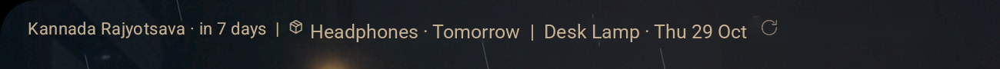

# Glance TV

A lean, good-looking Android TV home screen: daily Bing wallpaper, clock and weather, your apps, and a single status line for what's coming up.

## Screenshots



Status line with the next holiday and upcoming orders:



More: [Floating icons](docs/screenshots/floating-icons-rain.png) · [Glass tiles](docs/screenshots/glass-tiles-layout-c.png) · [Tall posters](docs/screenshots/tall-posters-tilt.png) · [⋯ menu](docs/screenshots/more-menu.png)

## Features

- **Three launcher styles**: Floating icons (halo + reflection), Glass tiles, and Tall posters (tilt + glare). There's also an optional daily auto-switch between them.
- **Daily Bing wallpaper**: bright photos by day and darker ones at night, with a light blur and the photo credit. A refresh button shows a spinner while it works, then a green tick or a red cross. You can turn it off in settings.
- **Clock, date and weather**: live weather effects (rain and more), forecast + AQI panel, weather wallpapers.
- **Remote / Bluetooth battery**: Bluetooth device icons coloured by battery level and connection, with short device names.
- **Wi-Fi signal icon**, HDMI input tiles that use the real HDMI-CEC device names, plus auto-jump to HDMI.
- **Next-holiday countdown** on the top-left status line (bundled 2026–27 list, refreshed weekly from Nager.Date).
- **Orders status line**: upcoming deliveries (item + date, box icon) from a JSON URL you choose, with a refresh button and an optional refresh trigger URL. Data older than 24 h is ignored.
- **Orders column in All apps**: a scrollable column on the right with every order (out for delivery first, then by date): product photo, item, store · date and an Ordered → Shipped → Out → Delivered progress bar (optional `image` URL in the orders JSON). Press Right from the last grid column to scroll it, Left to go back.
- **Arcticons line icons** for popular streaming apps, and brand colours on focus.
- **All apps grid** with a soft brand-colour glow on the focused app, wallpaper backdrop with heavier blur and a 50% scrim.
- **Hidden apps**: long-press or Menu → Hide on a tile, then ⋯ → Hidden apps to bring them back.
- **Last used pill** for jumping back into the last app.

## Install

1. Download the latest APK from [Releases](https://github.com/pradhul/glance-tv/releases/latest).
2. Turn on ADB / network debugging on the TV, then:

```sh
adb connect <tv-ip>:5555
adb install -r glance-tv-v39.apk   # use the file name you downloaded
```

## Set as default home

Press the Home button on the remote and choose **Glance TV** → *Always*. If the TV doesn't ask, open Settings → Apps → Default apps → Home app (the path depends on the TV). On TVs that lock the stock launcher, see [docs/TROUBLESHOOTING.md](docs/TROUBLESHOOTING.md).

## Configuring orders

Point the launcher at any HTTPS URL that serves this JSON:

```json
{
  "updated": "2026-10-25T09:00:00+05:30",
  "orders": [
    { "store": "Amazon", "item": "USB-C cable", "status": "shipped", "eta": "2026-10-29" }
  ]
}
```

| Field | Notes |
|---|---|
| `updated` | ISO-8601 with offset, required. Snapshots older than 24 h are ignored. |
| `store`, `status` | Required. `status` can be `ordered`, `shipped`, `out_for_delivery`, `delivered` or `cancelled` (the last two are hidden). |
| `item` | Optional short name (cut to 18 characters). |
| `eta` | Optional `YYYY-MM-DD`, shown as Today / Tomorrow / `Thu 29 Oct`. |

Orders are off by default (there is no built-in URL). Up to 3 orders are shown and the URL is polled every 10 minutes. Set it over ADB (works on release builds):

```sh
adb shell am start -n com.minimaltv.home/.MainActivity --es ordersUrl "https://example.com/orders.json"
```

Optionally set `orders_refresh_url`, an endpoint that is POSTed when you press the refresh button (e.g. a proxy that starts a `workflow_dispatch`). The launcher then waits about 60 s and re-fetches the orders URL:

```sh
adb shell am start -n com.minimaltv.home/.MainActivity --es ordersRefreshUrl "https://example.com/refresh"
```

To turn either one off again, set it to an empty string, e.g. `adb shell "am start -n com.minimaltv.home/.MainActivity --es ordersUrl ''"`.

To keep the JSON up to date from your order emails, see the companion GitHub Action: **[pradhul/tv-orders-sync](https://github.com/pradhul/tv-orders-sync)**.

## Building from source

Requires JDK 17 and the Android SDK (minSdk 26).

```sh
cd launcher
./gradlew assembleRelease     # or assembleDebug
./gradlew test                # Robolectric tests
```

## Roadmap / ideas

- Raspberry Pi home hub serving a single `/tv.json` for all status cards
- Arduino room sensors (temperature, humidity) and a doorbell card
- Live Swiggy / Zomato delivery tracking via a phone notification listener
- Live cricket score line
- AQI and power-cut alerts
- Trakt "Up next" and calendar
- Home network line (devices online, speed)

## Credits

- Forked from [kleviss/minimal-tv-launcher](https://github.com/kleviss/minimal-tv-launcher). Many thanks to the original author and contributors.
- App icons from [Arcticons](https://github.com/Arcticons-Team/Arcticons), licensed [CC BY-SA 4.0](https://creativecommons.org/licenses/by-sa/4.0/).
- Wallpapers from Bing's image of the day; holidays from [Nager.Date](https://date.nager.at).

## License

MIT. See [LICENSE](LICENSE). Arcticons icons remain under CC BY-SA 4.0.
